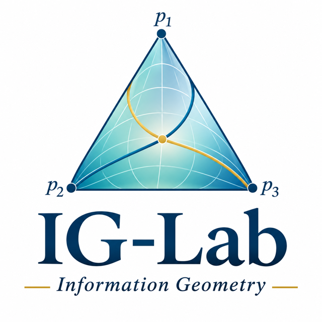
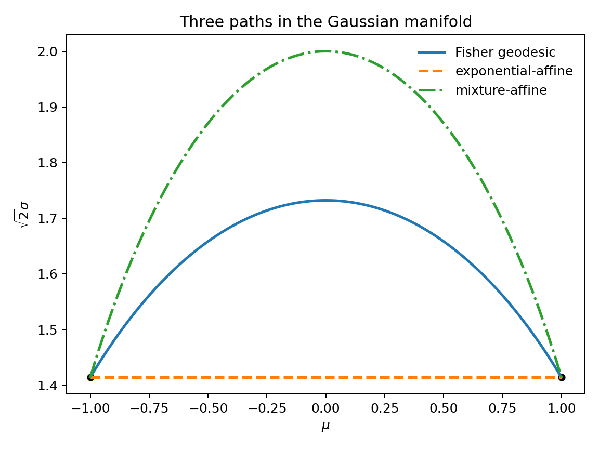

<p align="center">
  
</p>

# IG-Lab — Information Geometry for the Impatient

**When probability becomes geometry.**

Why is the space of Gaussian distributions hyperbolic? Why does the Fisher metric arise naturally from statistical experiments? What does it mean to take a straight path through a space of probability distributions, or to learn in a way that does not depend on arbitrary coordinates?

IG-Lab is the computational companion to *Information Geometry for the Impatient*, by **Mirco A. Mannucci (HoloMathics, LLC)**, part of the *Higher Math for the Impatient* series. It combines a concise mathematical book, executable examples, and a laboratory for exploring the geometry of statistical inference.

The aim is to develop structural intuition without sacrificing mathematical rigor. The book gives the derivations and proofs; the laboratory lets you investigate them.

## Read the book

**[Information Geometry for the Impatient — v0.2 (PDF)](book/Information_Geometry_for_the_Impatient_v0.2_COMPLETE.pdf)** · 37 pages · November 2026

Designed for readers familiar with calculus, linear algebra, and basic probability, the book develops:

- Fisher–Rao geometry of Gaussian and categorical distributions.
- Exponential and mixture connections, Legendre duality, and statistical curvature.
- The finite-simplex version of Čencov's uniqueness theorem and its proof.
- Fisher metric contraction under stochastic transformations.
- Divergence-induced geometry, Bregman divergences, and information projections.
- Natural gradients, mirror descent, and geometric learning dynamics.

The book includes worked exercises and additional proof problems. No software installation is required to read it.

## Explore the laboratory

| Notebook | Explore |
| --- | --- |
| [01 — Čencov and invariance](notebooks/01_cencov_uniqueness.ipynb) | Why stochastic refinement preserves the Fisher metric |
| [02 — Three Gaussian paths](notebooks/02_gaussian_three_paths.ipynb) | Fisher–Rao, exponential, and mixture interpolation |
| [03 — Duality and projection](notebooks/03_dual_projection.ipynb) | KL divergence, Bregman geometry, information projection |
| [04 — Natural gradients](notebooks/04_natural_gradient.ipynb) | Learning dynamics and coordinate dependence |



*Three different notions of straightness in the space of Gaussian distributions.*

## Quick start

Python 3.10 or later is required. Clone the repository and install the package:

```bash
git clone https://github.com/Mircus/IG-Lab.git
cd IG-Lab
python -m venv .venv
```

Activate the environment (`.\.venv\Scripts\Activate.ps1` on Windows PowerShell, or `source .venv/bin/activate` on Linux/macOS), then run:

```bash
python -m pip install -e ".[test,visual]"
python examples/quickstart.py
python -m pytest
jupyter lab
```

To regenerate the illustrations, run `python examples/make_figures.py`.

## Collaborate

IG-Lab welcomes readers, mathematicians, researchers, and developers who wish to improve the exposition, check the proofs, or extend the computational experiments.

Useful contributions include precise mathematical corrections, missing hypotheses and counterexamples, new worked examples, exercises, reproducible experiments, and numerical tests. Open an issue to discuss a question or propose an extension, or submit a focused pull request. See [CONTRIBUTING.md](CONTRIBUTING.md) for guidelines.

Possible directions include curved statistical models, more examples of sufficient statistics and information loss, Fisher–Rao versus Wasserstein geometry, and natural-gradient methods in machine learning. These are directions for future work, not claims of completed functionality.

## Repository layout

```text
book/          Current book (one PDF)
notebooks/     Guided computational experiments
examples/      Runnable scripts and figure generation
figures/       Generated illustrations
src/iglab/     Python implementation
tests/        Mathematical and numerical regression tests
manuscript/    Editorial sources and build instructions
docs/         Mathematical scope and research notes
assets/        Project logo
```

## About this edition

Version 0.2 is a working mathematical edition. The finite Čencov theorem is scoped to positive finite probability simplices and recoverable stochastic embeddings; numerical experiments are not proofs. See the [mathematical scope](docs/MATHEMATICAL_SCOPE.md) for assumptions and limitations, the [manuscript notes](manuscript/README.md) for rebuilding, and the [changelog](CHANGELOG.md) for release history.

**Author:** Mirco A. Mannucci · HoloMathics, LLC. If referring to this work, please cite the book title, author, edition, and repository URL. A reuse license has not yet been selected; please contact the maintainer about redistribution or modification.
